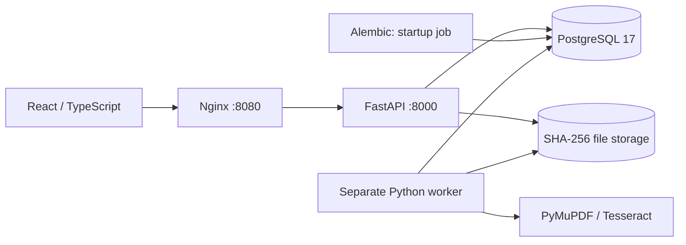

# Architecture — local core (milestones 1–4)

This is the implemented local architecture. Proposed Azure deployment, permission
inheritance and Microsoft alternatives are covered in the [production proposal](production.md).

Upload creates a logical document, its first revision and an original artifact in
one database transaction. JSONB `metadata` stores optional document metadata;
filename, type, size, hash and upload parameters belong to the artifact.
`requires_manual_review` is an original-artifact parameter inherited by processing.

Both extension and actual PDF/image contents are validated; a client MIME label is
not trusted. The API limits size before parsing; Nginx also limits the entire
request. FastAPI multipart uploads can spool temporary buffers to disk.

The API streams bytes to a temporary file, calculates SHA-256 and atomically
publishes at `ab/cd/<sha256>`. Existing content is hash-checked before reuse. Equal
bytes share a blob but retain separate artifact IDs. Metadata is committed after
publication. Downloads require an existing artifact ID; storage keys are not exposed.

The filesystem and PostgreSQL do not share a transaction. A failed DB commit can
leave an unreferenced blob. It is not automatically deleted because other artifacts
can share its contents. Garbage collection is not implemented.

The API provides upload, paginated lists, document/revision/artifact details,
downloads, processing/status/retry, explicit text reads and readiness. DB/storage
failures are visible; missing originals never become successful empty downloads.
Contract contents and SQL parameters are not written to error logs.

Constraints enforce positive revision numbers, uniqueness per document and source
artifacts belonging to the same revision. Artifacts cannot be mutated/deleted via
the API. Arbitrary provenance graphs and alternative uploads are not yet exposed.

## Processing and publication

`POST /api/revisions/{id}/process` accepts an original artifact ID and optional
review flag, returning 202. The ID can be omitted only with exactly one original.
Additional representations do not automatically change selected search text.
A partial unique index permits only one queued/running job per revision; conflicts
return 409.

The worker claims jobs using `FOR UPDATE SKIP LOCKED`, marks them running and
commits before CPU work. It verifies source size/hash. PDF pages with at least 20
embedded characters and no raster images use text extraction. Pages containing
images or too little text are rendered completely and OCR'd. This avoids a text
header concealing an unread scan, conservatively including digital pages with logos.

Tesseract returns words, boxes and actual word-confidence values. PDF coordinates
are points in x0/y0/x1/y1; OCR boxes use oriented/rendered-image pixels and
left/top/width/height. Images are limited to 25 million pixels; default PDF rendering
is 200 dpi. Timeouts/empty OCR are page problems, not missing-clause evidence.

Each run creates immutable `structured_json` and `extracted_markdown` artifacts.
JSON includes pages, text, methods, quality, coordinates, parameters and engine
versions. Artifact metadata, selected revision text, page text and completed job
are published in one DB transaction. Failed publication exposes no partial page
sets or derivative rows; unreferenced blobs remain possible as with upload.

Published partial extraction also replaces selected text, carrying its actual
quality. A failed run retains the previous selection and shows its error. Old
artifacts remain downloadable. Current selection identifies source, job and
normalization version. `POST /api/jobs/{id}/retry` creates a new job referencing the
failed predecessor and copying its parameters. Newly introduced review requirements
are additionally inherited without rewriting old parameters. Once flagged for a
source, manual review persists in subsequent runs for that source.

## Coverage, quality and text

UTF-8 TXT/HTML use the same pipeline with one logical page. HTML executes no scripts,
fetches no resources and always requires review; physical-page/layout fidelity is
not claimed. [Data evaluation](data-evaluation.md) covers inventory, synthetic images
and measured OCR.

Coverage (`complete`, `partial`, `unavailable`) is separate from quality
(`no_known_issue`, `needs_review`, `unassessed`). A flagged text page can be complete
and still need review. The UI provides a review group, originals, page text,
JSON/Markdown previews and run history. It polls actual API state every two seconds.
Full text is returned only by explicit text/file reads, not metadata lists.

Normalization v1 applies NFC, consistent line endings, collapsed/trimmed whitespace
and Unicode casefold. Numbers, negation, punctuation and hyphens remain; ambiguous
hyphenation is not repaired. Raw pages join with `\n\f\n`; nonempty normalized pages
join with one space. Page offsets reference that exact normalized string.

A completed job can contain unavailable or questionable pages. [Literal search](search.md)
examines the entire latest revision. Negative findings require full coverage, no
known quality issue and no source review flag. Positive findings retain warnings.
A read-only snapshot ties classification to snippets and page references. There are
no automatic retries, heartbeats or safe lease takeovers; see README recovery.
Extraction holds no database row locks during CPU work.

## Textual candidate retrieval

`POST /api/search/textual` uses the same latest-revision scope, provenance and
warnings as literal search. In a read-only snapshot RapidFuzz compares queries
with exact occurrences and variable word windows. Overlaps are consolidated;
multiple occurrences retain scores for the displayed passage and consistent page
references. There is no additional candidate index or silent top-k cutoff.

[Candidate rules](textual-search.md) and explicit resource errors expose full-scan
limits. This retrieves possible positives, not legal equivalence or absence.
A database-free assessment endpoint evaluates query/threshold risk with the same
server guidance used by retrieval/UI. Compute, per-document/global occurrence and
density budgets can abort a run. Structured errors contain partial observations,
not a successful partial result list.

The optional [semantic stage](semantic-search.md) assesses fully retrieved textual
passages using a pinned ONNX CPU model downloaded at build time. Cache identity
includes actual text and model/pipeline version; there is no precomputed document
embedding index. Filtering precedes counts/pagination and preserves textual ranking
and source references. Model failures/budgets do not return successful subsets.
Literal absence semantics remain unchanged.

[Reviews](passage-reviews.md) store current states in `passage_reviews`, bound to job,
comparison expression/mode and occurrence. Fingerprints/FKs bind the source.
Live-source writes lock and validate selected text; expected versions prevent lost
updates. Ephemeral search reads remain read-only and project decisions in the same
snapshot, counting after similarity and filtering before pagination. New processing
runs do not inherit old decisions.

[Performance measurements](search-performance.md) separate matching, model/cache and
HTTP costs. Optimized windows preserve scores and budgets; complete embedding-cache
hits avoid directory scans. The bounded evidence does not justify a new index or
search-snapshot queue by itself.

[Saved searches](saved-search-runs.md) capture all positive matches and historical
scope in one read snapshot, then persist atomically. Text is archived per processing
job with integrity checks. Reopening needs neither matcher nor model. Current
reviews overlay preserved capture-time states; historical writes validate archived
membership/source. The [workspace](review-workspace.md) navigates bounded full saved
results. [Exports](search-exports.md) preserve provenance and a consistent review view.
