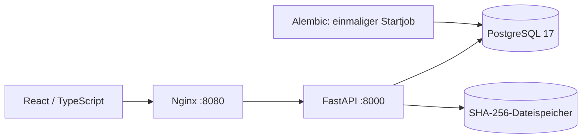

# Architektur — Meilenstein 1

Beim Upload entstehen in einer Datenbanktransaktion ein logisches Dokument,
dessen erste Revision und ein Originalartefakt. Das JSONB-Feld `metadata` enthält
optionale Metadaten; Dateiname, Typ, Größe, Hash und Uploadparameter sind am
Artefakt gespeichert. Das Feld `requires_manual_review` wird am Originalartefakt
als Parameter aufbewahrt, damit die spätere Verarbeitung es übernehmen kann.

Dateiendung und tatsächlicher PDF-/Bildinhalt werden geprüft; das clientseitige
MIME-Label wird nicht als Nachweis akzeptiert. Die API begrenzt die Dateigröße vor
der Dateiparser-Prüfung, Nginx zusätzlich den gesamten Request. FastAPI verwendet
für Multipart-Dateien einen temporären, auf Disk auslagerbaren Uploadpuffer.

Die API schreibt Bytes in eine temporäre Datei, berechnet SHA-256 und veröffentlicht
die Datei atomar unter `ab/cd/<sha256>`. Eine vorhandene Datei wird vor der
Wiederverwendung auf ihren Hash geprüft. Gleiche Bytes teilen sich den Blob,
behalten aber getrennte Artefakt-IDs. Nach der Veröffentlichung werden die
Metadaten committed. Ein Download ist ausschließlich über eine vorhandene
Artefakt-ID möglich; interne Storage-Schlüssel erscheinen nicht in der API.

Blob-Dateisystem und PostgreSQL haben keine gemeinsame Transaktion. Scheitert
der Datenbankcommit, kann ein nicht referenzierter Blob zurückbleiben; er wird
nicht automatisch gelöscht, weil andere Artefakte denselben Inhalt nutzen können.
Ein Garbage Collector ist für diesen Meilenstein nicht implementiert.

Die API bietet Upload, paginierte Liste, Dokument-/Revisions-/Artefaktdetails,
Dateidownload und Readiness. Fehler in Datenbank oder Storage liefern einen
sichtbaren Fehler; fehlende Originalbytes werden nicht als erfolgreicher leerer
Download ausgegeben. Verträge und SQL-Parameter werden nicht in Fehlerlogs geschrieben.

Datenbank-Constraints sichern positive Revisionsnummern, eindeutige Nummern pro
Dokument sowie Quellenartefakte derselben Revision. Es gibt keine Mutation oder
Löschung von Artefakten über die API. Beliebige Provenienzgraphen und alternative
Uploads sind noch nicht exponiert.

Worker, OCR, Texttabellen und Suche folgen in Meilensteinen 2–3. Daher enthält
Compose noch keinen funktionslosen Worker-Service. Die Oberfläche nennt den
realen Status `not_processed` und stellt keine Suchbedienelemente vorzeitig bereit.
