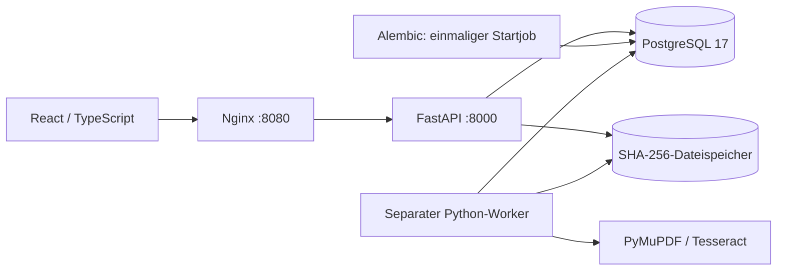

# Architektur — lokaler Core (Meilensteine 1–4)

Dies ist die implementierte lokale Architektur. Die vorgeschlagene Azure-Zuordnung,
Rechteübernahme und Microsoft-Alternativen stehen im [Produktionskonzept](production.md).

Beim Upload entstehen in einer Datenbanktransaktion ein logisches Dokument,
dessen erste Revision und ein Originalartefakt. Das JSONB-Feld `metadata` enthält
optionale Metadaten; Dateiname, Typ, Größe, Hash und Uploadparameter sind am
Artefakt gespeichert. Das Feld `requires_manual_review` wird am Originalartefakt
als Parameter aufbewahrt und in jeden Verarbeitungslauf übernommen.

Dateiendung und tatsächlicher PDF-/Bildinhalt werden geprüft; das clientseitige
MIME-Label wird nicht als Nachweis akzeptiert. Die API begrenzt die Dateigröße vor
der Dateiparser-Prüfung, Nginx zusätzlich den gesamten Request. FastAPI verwendet
für Multipart-Dateien einen temporären, auf Disk auslagerbaren Uploadpuffer.

Die API schreibt Bytes in eine temporäre Datei, berechnet SHA-256 und veröffentlicht
die Datei atomar unter `ab/cd/<sha256>`. Eine vorhandene Datei wird vor der
Wiederverwendung auf ihren Hash geprüft. Gleiche Bytes teilen sich den Blob,
behalten aber getrennte Artefakt-IDs. Nach der Veröffentlichung werden die
Metadaten committed. Ein Download ist ausschließlich über eine vorhandene
Artefakt-ID möglich; interne Storage-Schlüssel erscheinen nicht in der API.

Blob-Dateisystem und PostgreSQL haben keine gemeinsame Transaktion. Scheitert
der Datenbankcommit, kann ein nicht referenzierter Blob zurückbleiben; er wird
nicht automatisch gelöscht, weil andere Artefakte denselben Inhalt nutzen können.
Ein Garbage Collector ist für diesen Meilenstein nicht implementiert.

Die API bietet Upload, paginierte Liste, Dokument-/Revisions-/Artefaktdetails,
Dateidownload, Verarbeitungsstart/-status/-wiederholung, expliziten Textabruf und
Readiness. Fehler in Datenbank oder Storage liefern einen
sichtbaren Fehler; fehlende Originalbytes werden nicht als erfolgreicher leerer
Download ausgegeben. Verträge und SQL-Parameter werden nicht in Fehlerlogs geschrieben.

Datenbank-Constraints sichern positive Revisionsnummern, eindeutige Nummern pro
Dokument sowie Quellenartefakte derselben Revision. Es gibt keine Mutation oder
Löschung von Artefakten über die API. Beliebige Provenienzgraphen und alternative
Uploads sind noch nicht exponiert.

## Verarbeitung und Veröffentlichung

`POST /api/revisions/{id}/process` nimmt die Originalartefakt-ID und optional eine
Prüfvormerkung entgegen und antwortet mit 202. Nur wenn genau ein Original
vorliegt, darf seine ID weggelassen werden. Weitere Repräsentationen wählen den
Index nicht automatisch um. Ein partieller eindeutiger Index erlaubt höchstens
einen queued/running Job pro Revision; Konflikte liefern 409.

Der Worker beansprucht einen Job mit `FOR UPDATE SKIP LOCKED`, markiert ihn als
laufend und committet vor der CPU-Arbeit. Er kontrolliert Größe und SHA-256 der
Quelle. Für PDF-Seiten mit mindestens 20 Zeichen und ohne Rasterbilder nutzt er
die Textschicht; Seiten mit Bildern oder wenig Text werden vollständig gerendert
und OCR unterzogen. Damit geht der Scaninhalt neben einem eingebetteten Header
nicht verloren. Diese konservative Regel OCRt auch digitale Seiten mit Logos.

Tesseract liefert Wörter, Bounding Boxes und echte Wort-Konfidenzwerte. PDF-Boxes
verwenden Punkte und x0/y0/x1/y1; OCR-Boxes beziehen sich auf das gerenderte,
orientierte Bild in Pixeln und left/top/width/height. Bilder werden auf maximal
25 Millionen Pixel begrenzt, PDF-Rendering standardmäßig auf 200 dpi. Ein Timeout
oder ein leerer OCR-Text wird als Seitenproblem sichtbar, nicht als fehlende Klausel.

Der Lauf erzeugt zwei neue immutable Artefakte, `structured_json` und
`extracted_markdown`. Das JSON enthält Seiten, Text, Verfahren, Qualität,
Koordinaten, Parameter und Engine-Versionen. In einer Datenbanktransaktion werden
Artefaktmetadaten, ausgewählter Revisionstext, Seitentexte und der abgeschlossene
Job veröffentlicht. Bei Datenbankfehlern bleiben weder halbe Seitensätze noch
derivative Artefaktzeilen sichtbar. Nicht referenzierte Blob-Dateien sind wie
beim Upload möglich; ein Garbage Collector bleibt offen.

Erfolgreich veröffentlichte Teilergebnisse ersetzen ebenfalls den ausgewählten
Index und tragen ihre tatsächliche Qualität. Ein fehlgeschlagener Lauf erhält
den vorherigen ausgewählten Index; seine Fehlermeldung ist daneben sichtbar.
Alte Laufartefakte bleiben herunterladbar. Die aktuelle Auswahl nennt eindeutig
Quellartefakt, Job und Normalisierungsversion. `POST /api/jobs/{id}/retry` erstellt
einen neuen Job mit übernommenen Parametern und Verweis auf den fehlgeschlagenen
Vorgänger. Ein inzwischen hinzugekommener manueller Prüfbedarf wird beim Retry
zusätzlich übernommen; die alten Laufparameter bleiben unverändert erhalten.
Ein pro Lauf gesetzter manueller Prüfbedarf wird für dieselbe Quelle
auch in späteren Läufen beibehalten.

## Abdeckung, Qualität und Text

TXT- und HTML-Originale nutzen dieselbe Pipeline, mit UTF-8-Validierung und einer
logischen Seite. HTML wird ohne Skriptausführung oder Ressourcenabruf als Text
gelesen und immer zur Prüfung markiert. Physische Seiten oder Layouttreue werden
dabei nicht behauptet. [Import und Evaluation](data-evaluation.md) beschreibt
Quelleninventar, die synthetischen Bilddaten und die gemessene OCR-Basis.

Abdeckung (`complete`, `partial`, `unavailable`) und Qualität (`no_known_issue`,
`needs_review`, `unassessed`) sind getrennte Felder. Eine Seite mit Text und
manueller Prüfvormerkung ist beispielsweise vollständig verarbeitet und trotzdem
prüfbedürftig. Die Oberfläche zeigt eine eigene Prüfgruppe sowie Originaldownload,
Seitentext, JSON-/Markdown-Vorschau und Laufhistorie. Sie pollt den realen API-Stand
alle zwei Sekunden. Volltext wird nur über den expliziten Text-/Dateiabruf
zurückgegeben, nicht in Dokumentlisten und Metadaten.

Normalisierung v1: Unicode NFC, einheitliche Zeilenenden, Whitespace auf ein
Leerzeichen reduzieren, Randwhitespace entfernen und Unicode-Casefold. Zahlen,
Negationen, Satzzeichen und Bindestriche bleiben erhalten; es gibt bewusst keine
mehrdeutige Silbentrennungsreparatur. Rohtext verbindet Seiten mit `\n\f\n`;
normalisierter Text verbindet nichtleere Seiten mit einem Leerzeichen. Die
Seitenoffsets beziehen sich exakt auf diesen gespeicherten normalisierten String.

Ein Job kann technisch abgeschlossen sein, obwohl einzelne Seiten unverfügbar
oder prüfbedürftig sind. Die [Volltextsuche](search.md) prüft die ganze neueste
Revision. Negative Ergebnisse erfordern vollständige Abdeckung, keine bekannte
Qualitätsauffälligkeit und keine manuelle Prüfvormerkung für die Quelle. Positive
Treffer auf unsicheren Extraktionen behalten ihre Warnungen. Ein Read-only-Snapshot
verbindet die globale Klassifikation mit Ausschnitten und Seitenpositionen.
Automatische Wiederholung, Heartbeats und sichere Lease-Übernahme sind noch nicht
implementiert; die README beschreibt den expliziten Wiederherstellungsablauf nach
Worker-Abbruch. Während der Extraktion bleiben keine Datenbank-Rowlocks offen.

## Textuelle Kandidatensuche

`POST /api/search/textual` verwendet dieselbe Auswahl der neuesten Revision,
Provenienz und Qualitätswarnungen wie die Literalsuche. In einem eigenen
Read-only-Snapshot vergleicht RapidFuzz den Suchtext mit exakten Vorkommen und
variablen Wortfenstern. Überlappende Kandidaten werden konsolidiert; mehrere
Fundstellen bleiben je Dokument blätterbar. Der Score bezieht sich auf die
tatsächlich angezeigte Passage. Fundstellen und Seiteninformationen stammen aus
demselben Snapshot. Es gibt kein zusätzliches Indexschema oder stilles Top-k-Limit.

Die [Kandidatenregeln](textual-search.md) und vollständige Ressourcenfehler machen
die Grenzen des aktuellen Vollscans sichtbar. Dieser Ablauf liefert mögliche
positive Treffer; er darf keine juristische Äquivalenz oder Abwesenheit feststellen.

Ein datenbankfreier Vorab-Endpunkt bewertet den Suchausdruck und die Schwelle;
Suchlauf und Oberfläche verwenden dieselben serverseitigen Hinweise. Zusätzlich
zu Rechenbudgets gelten Grenzen für konsolidierte Fundstellen je Dokument, im
Gesamtbestand und für dichte approximative Treffer. Ein Abbruch liefert eine
strukturierte Fehlerantwort mit Teilbeobachtungen, aber ohne erfolgreiche
Ergebnisliste. Die Einzelheiten stehen in der [Suchsteuerung](textual-search.md).

Die optionale [semantische Stufe](semantic-search.md) bewertet erst die vollständig
ermittelten textuellen Fundstellen. Ein fest versioniertes, beim Build geladenes
ONNX-Modell läuft lokal auf CPU. Der Cache adressiert den konkreten Text samt
Modell-/Pipeline-Version, ohne einen vorab berechneten Dokumentindex einzuführen.
Semantische Filterung erfolgt vor Zählung und Pagination; Rangfolge, Textbezug und
Quellennachweis bleiben erhalten. Modellfehler und zusätzliche Ressourcenbudgets
liefern keine erfolgreiche Teilmenge. Die exakte Abwesenheitssuche ist unverändert.
