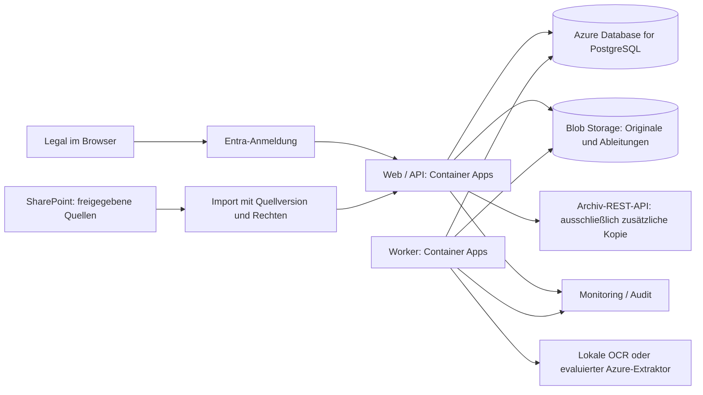

# Produktionskonzept und Technologievergleich

Stand: 30.10.2026. **Entwurf, nicht ausgerollt oder benchmarked.** Der aktuelle
lokale Stand ist in [Architektur](architecture.md) dokumentiert. Diese Zuordnung
schlägt einen möglichen Produktionspfad vor; sie ist keine Produktionsfreigabe.

## Vorgeschlagene Azure-Zuordnung

Die Pfeile sind beabsichtigte Datenflüsse, keine bereits implementierten Connectoren.

| Lokaler Baustein | Vorschlag | Vor Umsetzung zu klären |
|---|---|---|
| Nginx/React und FastAPI | Container Apps mit HTTPS und Entra-Anmeldung | Tokenvalidierung, Sitzungen, Rechteprüfung aller API-Routen; API nicht neben dem Gateway offen lassen |
| Python-Worker | Separater Container-App-Dienst; anfangs mindestens eine aktive Instanz für DB-Polling | CPU/RAM nach OCR-Messung, Wiederanlauf, Heartbeat/Lease und idempotente Veröffentlichung; Scale-to-zero würde den heutigen Poller anhalten |
| PostgreSQL | Azure Database for PostgreSQL | Private Anbindung, Version, Backups, Restore-Test, Lastmessung und Kosten |
| Dateivolume | Blob Storage über neuen Storage-Adapter | Unveränderliche Originale, Hashprüfung, atomare Veröffentlichung und Umgang mit verwaisten Objekten; bestehender Dateisystem-Code ist kein Cloud-Adapter |
| Lokale Standardkonfiguration | Managed Identities und getrennte Dienstrechte | Least Privilege, Secretverwaltung für verbleibende Geheimnisse und Trennung von Umgebungen |
| Lokale Logs/Health | Zentrale Metriken, Alarmierung und Audit | Keine Vertragstexte oder Suchpassagen in Logs; Zugriffe und Verarbeitungsläufe nachvollziehbar halten |

Container Apps dokumentiert API- und Hintergrundworkloads. Managed Identities
ermöglichen Dienstzugriffe ohne im Anwendungscode verwaltete Zugangsdaten;
Ressourcenrechte müssen separat vergeben werden.
[Container Apps](https://learn.microsoft.com/en-us/azure/container-apps/overview),
[Managed Identities](https://learn.microsoft.com/en-us/azure/container-apps/managed-identity).
PostgreSQL und Blob Storage sind vorgeschlagene verwaltete Entsprechungen der
heutigen Datenbank und Dateiablage.
[PostgreSQL](https://learn.microsoft.com/en-us/azure/postgresql/overview),
[Blob Storage](https://learn.microsoft.com/en-us/azure/storage/blobs/storage-blobs-overview).

Terraform und CI/CD würden diese Ressourcen später reproduzierbar bereitstellen.
Es gibt hier keine Terraform-Dateien, Cloud-Schlüssel oder Live-Integrationen.
Ein zusätzlicher Broker oder Suchcluster ist erst bei belegtem Bedarf vorgesehen.

## Quellen, Rechte und Archiv

SharePoint ist die führende Quelle. Ein künftiger Import muss stabile Quell-ID,
Quellversion, Änderungsstand und Herkunft speichern. Gleiche Quellversionen dürfen
bei Wiederholung keine neue Vertragsrevision erzeugen. Inhaltsänderungen und
neue Extraktionsläufe müssen weiterhin verschieden bleiben.

Vor privaten Daten ist ein abgestimmtes Berechtigungsmodell erforderlich:

- Zugriff auf Dokumentliste, Treffer, Snippets, globale Zählungen, Text und Downloads
  jeweils auf berechtigte Quellen beschränken. Auch Zählungen können Inhalte verraten.
- Berechtigungsänderungen und Quellenlöschungen übernehmen; bei unbekanntem oder
  veraltetem Rechtezustand keinen Zugriff gewähren. Entra-Anmeldung allein reicht nicht.
- Auch Ableitungen, Suchtexte, alte Laufartefakte, Caches und Backups in Aufbewahrung,
  Löschung und Legal-Hold-Regeln einbeziehen. „Immutable“ in diesem Prototyp bedeutet
  keine Änderungs-API und ist kein rechtliches Retention-Konzept.
- Importfehler und noch nicht synchronisierte Quellen sichtbar halten. Eine
  Negativsuche gilt nur für den explizit ausgewiesenen untersuchten Bestand.

Die eingeschränkte Archiv-REST-API darf nur eine zusätzliche Vertragskopie erhalten.
Dafür braucht es einen idempotenten Export mit Quellhash, Zustellnachweis und
sichtbaren Fehlern; dieser Export ersetzt keine Rechteprüfung oder Suche. Die
Case Study erlaubt keine Nutzung des Archivs als allgemeines Lesebackend.

## Vergleich der Extraktion und vorhandener Microsoft-Wege

Offizielle Quellen wurden am 30.10.2026 geprüft. Dokumentierte Funktionen sind
keine Messresultate auf Riverty-Verträgen. Die folgende Auswahlentscheidung ist
eine Hypothese bis zur Evaluation.

| Kriterium | Lokale PyMuPDF-/Tesseract-Basis | Azure Document Intelligence Read | SharePoint OCR und vorhandene Suche |
|---|---|---|---|
| Digital-PDF / Druckscan | Im Prototyp mit echter Textschicht und OCR geprüft | PDF-/Bild-OCR dokumentiert; hier nicht aufgerufen | OCR für Bilder, gescannte und hybride PDFs dokumentiert; hier nicht aktiviert |
| Handschrift | Kein belastbarer Nachweis; manuelle Prüfung | Druck und Handschrift dokumentiert, Sprach-/Modellversion prüfen; historische Schrift ungemessen | Handschrift laut Dienstbeschreibung; Qualität im konkreten Bestand ungemessen |
| Quellenbelege | Eigene Seite, Ausschnitt, Original, Lauf und Artefakte | Liefert Text und Positionsdaten; Adapter in dieselbe Provenienz nötig | Extraktion wird indexiert; bei PDF/TIFF ist der OCR-Text laut Doku nicht als Metadatenspalte verfügbar |
| Negativsuche | Expliziter Volltext-/Qualitätsvertrag umgesetzt | Extraktor allein implementiert diesen Suchvertrag nicht | Zu prüfen: vollständiger Bestand, Indexierungsfehler, Prüfbedarf und Wortlautregeln; kein Beleg aus einer leeren Trefferliste |
| Betrieb / offline | Nach Build offline; eigenes Patchen und OCR-Tuning | Cloud-Dienst, Integration und Dienstfehler behandeln; keine Offline-Abhängigkeit im Core | Tenant-Konfiguration und Dienstverfügbarkeit erforderlich; Bestandsmigration separat klären |
| Latenz / Kosten | Lokaler Ressourcenverbrauch; noch keine Lastmessung | Keine gemessenen Zeiten/Kosten; Angebot für Region, Tarif und Seitenvolumen ermitteln | Lizenz-/Abrechnungs- und Tenantvoraussetzungen vor Pilot prüfen; keine Kostenbehauptung |
| Datenverarbeitung | Kein externer Versand zur Laufzeit | Übertragung zu einem Cloud-Dienst; Region, Vertrag, Aufbewahrung und Löschweg vorab prüfen | Verarbeitung im M365-Kontext; Zugriff und Governance im Tenant prüfen |

Quellen zum Vergleich: Tesseract bezeichnet Handschrift in seiner
[FAQ](https://tesseract-ocr.github.io/tessdoc/FAQ.html#can-i-use-tesseract-for-handwriting-recognition)
als problematischen Einsatz. Microsoft dokumentiert PDF-/Bildextraktion,
Handschrift und Positionen für
[Read v4](https://learn.microsoft.com/en-us/azure/ai-services/document-intelligence/prebuilt/read?view=doc-intel-4.0.0).
Für Handschrift nennt die
[Sprachtabelle](https://learn.microsoft.com/en-us/azure/ai-services/document-intelligence/language-support/ocr?view=doc-intel-4.0.0)
unter anderem Deutsch und Englisch; das ist keine Zusage für historische Schriften.
[SharePoint OCR](https://learn.microsoft.com/en-us/microsoft-365/documentprocessing/ocr-overview?view=o365-worldwide)
beschreibt die Indexierung und Einschränkungen, darunter Verarbeitung neu
hochgeladener Bilder nach Aktivierung. Die Dokumentation begründet keine Annahme,
dass alle vorhandenen Altverträge automatisch neu verarbeitet werden.

Für Azure Read dokumentiert Microsoft bei v4 bis zu 2.000 PDF-/TIFF-Seiten;
im F0-Tarif werden nur die ersten zwei Seiten verarbeitet. Das ist bei einem
künftigen Adapter als Teilabdeckung zu behandeln. Modell/API-Version, Tarif,
Region und tatsächliche verarbeitete Seiten müssen pro Lauf gespeichert werden.
[Read-Eingabegrenzen](https://learn.microsoft.com/en-us/azure/ai-services/document-intelligence/prebuilt/read?view=doc-intel-4.0.0#input-requirements-v4).

## Auswahl durch gemeinsame Evaluation

Die Offline-Basis wurde für eine prüfbare Demo ohne Zugangsdaten gewählt.
Eine Produktionsentscheidung zugunsten lokaler oder Microsoft-Extraktion folgt
daraus nicht. Zuerst vorhandene M365-Möglichkeiten prüfen; bei fehlenden Belegen
oder Qualitätssteuerung einen eigenen Workflow mit austauschbarem Extraktor evaluieren.

Für denselben freigegebenen Referenzbestand beide Extraktoren getrennt ausführen.
Digitale Dokumente, Druckscans und Handschrift getrennt berichten. Legal erstellt
bekannte Dokument-Passagen-Paare inklusive Zahlen, Negationen, Firmennamen und
Seitenübergängen; unlesbare Stellen bleiben als unsicher annotiert. Abstimmung
von Heuristiken und endgültige Bewertung auf getrennten Teilmengen durchführen.

Erfassen: positive Präzision/Recall, fehlerhafte Abwesenheitsvorschläge,
unverifizierbarer Anteil, manuelle Prüfminuten, Seitenbelege, OCR-Zeichenfehler,
Latenz und Kosten pro tatsächlich verarbeiteter Seite. Auch gescheiterte und
partielle Läufe einschließen. Schwellenwerte vor der Auswertung mit Legal
vereinbaren; generische OCR-Scores sind keine vergleichbaren Wahrscheinlichkeiten.

Ein besserer Extraktor muss weiterhin Abdeckung, Warnungen, Quellhash und
Versionen liefern. Ohne belegte Qualität bleiben schwierige Handschriften im
manuellen Workflow. Eine spätere semantische Suche würde separat auf juristische
Fehlinterpretationen geprüft und dürfte die Literal-Negativsuche nicht ersetzen.

## Betriebliches Freigabetor

Vor Produktivdaten benötigen die zuständigen Teams eine Abnahme von Berechtigungen,
Datenschutz/Region/Retention, Audit und Incident-Prozess sowie demonstrierten
Backup-/Restore- und Wiederanlaufverfahren. Lasttests müssen Korpusgröße,
Suchlatenz und OCR-Durchsatz abdecken; heutige Vollscans sind nicht dafür vermessen.
Ownership: Legal verantwortet Referenzset und fachliche Abnahme; Engineering
Verarbeitung und Support; Plattform/Sicherheit Identität, Infrastruktur und
Betriebsfreigabe. Der [Präsentationsleitfaden](presentation.md) beschreibt den
Nutzerpilot und die zu vereinbarenden Erfolgskriterien.
