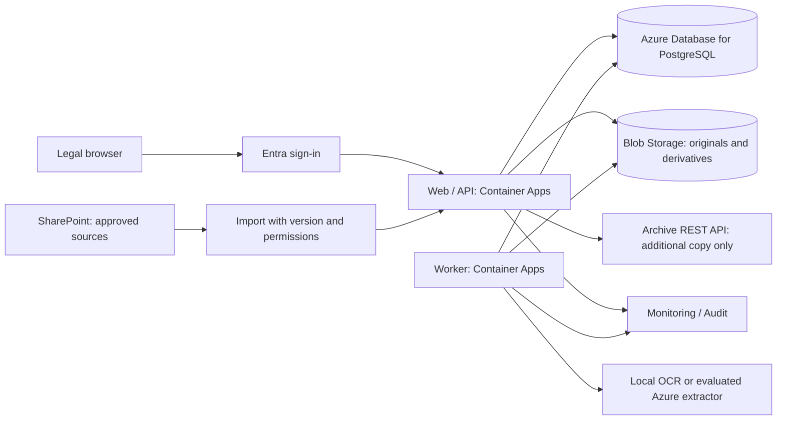

# Production proposal and technology comparison

Proposal originally dated 30 October 2026: **not deployed or benchmarked**.
The implemented local system is described in [architecture](architecture.md).
This is a possible production path, not production approval. External-source
references below retain their original review date; translation is not a fresh
verification of cloud capabilities or prices.

## Proposed Azure mapping

Arrows are intended data flows, not implemented connectors.

| Local component | Proposal | Resolve before implementation |
| --- | --- | --- |
| Nginx/React and FastAPI | Container Apps, HTTPS and Entra sign-in | Tokens, sessions and authorization on every route; no exposed API bypass |
| Python worker | Separate Container App, initially at least one active DB-polling instance | Measured CPU/RAM, recovery, heartbeat/lease and idempotent publication; scale-to-zero stops today's poller |
| PostgreSQL | Azure Database for PostgreSQL | Private connectivity, version, backups, restore tests, load and cost |
| File volume | Blob Storage through a new adapter | Immutable originals, hashes, atomic publication and orphan handling; filesystem code is not a cloud adapter |
| Local configuration | Managed Identities and separate service permissions | Least privilege, remaining secrets and environment separation |
| Logs/health | Central metrics, alerting and audit | No contract/query text in logs; traceable accesses and processing |

Container Apps documents API/background workloads. Managed Identities remove
application-managed service credentials, but resource rights still need assignment:
[Container Apps](https://learn.microsoft.com/en-us/azure/container-apps/overview),
[Managed Identities](https://learn.microsoft.com/en-us/azure/container-apps/managed-identity).
Managed database/storage equivalents:
[PostgreSQL](https://learn.microsoft.com/en-us/azure/postgresql/overview),
[Blob Storage](https://learn.microsoft.com/en-us/azure/storage/blobs/storage-blobs-overview).

Terraform and CI/CD could provision these later. There are no Terraform resources,
cloud keys or live integrations here. Add brokers/search clusters only for proven need.

## Sources, rights and archive

SharePoint remains authoritative. Import needs stable source ID/version, change
state and provenance. Reimporting the same version must not create another contract
revision. Content changes remain distinct from extraction attempts.

Before private data:

- Authorize lists, results, snippets, counts, text and downloads by source rights;
  even counts can leak contents.
- Propagate permission changes/deletions. Deny unknown/stale permission states;
  Entra authentication alone is insufficient.
- Include derivatives, text, historical artifacts, caches and backups in retention,
  deletion and legal hold. Prototype immutability is not a legal retention policy.
- Expose import failures/unsynchronized sources. Absence checks concern only the
  explicitly identified examined collection.

The restricted archive REST API receives only an additional copy. It needs
idempotent delivery, source hashes, receipt evidence and visible failures, without
replacing authorization or search. The case study does not permit treating that
archive as a general read backend.

## Extraction and existing Microsoft alternatives

Official sources were reviewed on **30 October 2026**. Documented capabilities are
not measured results on Riverty contracts; selection remains a hypothesis pending
evaluation.

| Criterion | Local PyMuPDF/Tesseract | Azure Document Intelligence Read | SharePoint OCR and existing search |
| --- | --- | --- | --- |
| Digital PDF / print scan | Real text/OCR checked locally | PDF/image OCR documented; not called here | Image/scanned/hybrid PDF OCR documented; not enabled here |
| Handwriting | No reliable evidence; manual review | Print/handwriting documented; verify language/model, historical writing unmeasured | Service describes handwriting; actual corpus quality unmeasured |
| Evidence | Page, snippet, original, run and artifacts | Text/positions need mapping into our provenance | Indexed extraction; PDF/TIFF OCR text not available as a metadata column according to documentation |
| Negative findings | Explicit full-text/quality contract implemented | Extractor alone does not implement search semantics | Must verify complete scope, indexing errors, review requirements and wording; an empty list proves nothing |
| Operation / offline | Offline after build; maintain patches/OCR tuning | Cloud integration/failures to handle; no runtime cloud dependency in core | Tenant setup/service availability; migration to assess separately |
| Latency / cost | Local resources; original proposal had no load measurement | No measured cost/time; determine region/tier/page-volume offer | Verify licensing/billing/tenant requirements before pilot; no cost claim |
| Data processing | No runtime external transfer | Review region, agreement, retention/deletion before cloud transfer | M365 processing; verify tenant access/governance |

Tesseract describes handwriting as problematic in its
[FAQ](https://tesseract-ocr.github.io/tessdoc/FAQ.html#can-i-use-tesseract-for-handwriting-recognition).
Microsoft documents text, handwriting and position extraction in
[Read v4](https://learn.microsoft.com/en-us/azure/ai-services/document-intelligence/prebuilt/read?view=doc-intel-4.0.0).
The [language table](https://learn.microsoft.com/en-us/azure/ai-services/document-intelligence/language-support/ocr?view=doc-intel-4.0.0)
includes English/German handwriting, not a promise for historical scripts.
[SharePoint OCR](https://learn.microsoft.com/en-us/microsoft-365/documentprocessing/ocr-overview?view=o365-worldwide)
describes indexing/limits, including newly uploaded images after enablement; it does
not establish automatic reprocessing of all old contracts.

Read v4 documents up to 2,000 PDF/TIFF pages, while F0 processes only the first two.
A future adapter must treat this as partial coverage and record model/API version,
tier, region and actual processed pages per run.
[Input limits](https://learn.microsoft.com/en-us/azure/ai-services/document-intelligence/prebuilt/read?view=doc-intel-4.0.0#input-requirements-v4).

## Select through shared evaluation

The offline baseline supports reproducible demos without credentials; it does not
settle production extractor choice. Evaluate existing M365 first, then a custom
workflow with replaceable extraction if evidence/quality controls justify it.

Run both extractors on the same approved reference set. Report digital, printed
and handwritten results separately. Legal labels document-passage pairs including
numbers, negation, names and page crossings; unreadable spans remain uncertain.
Keep heuristic tuning separate from final evaluation.

Measure precision/recall, false absence, unverifiable fraction, manual review time,
page evidence, OCR character errors, latency and cost per actually processed page.
Include failed/partial runs. Agree acceptance thresholds with Legal beforehand;
generic OCR scores are not comparable probabilities. A better extractor must still
expose coverage, warnings, hashes and versions. Poor handwriting stays manual.
Current optional semantic comparison also needs legal-error evaluation and cannot
replace literal absence checks.

## Operational release gate

Before production data, obtain approval for authorization, privacy/region/retention,
audit/incidents and demonstrated backup/restore/recovery. Load tests must cover
corpus size, search latency and OCR throughput; bounded local measurements do not
establish production scale. Legal owns reference data/business acceptance,
Engineering processing/support, and Platform/Security identity, infrastructure and
operational release. The [presentation guide](presentation.md) covers the proposed
user pilot and success criteria to agree.
