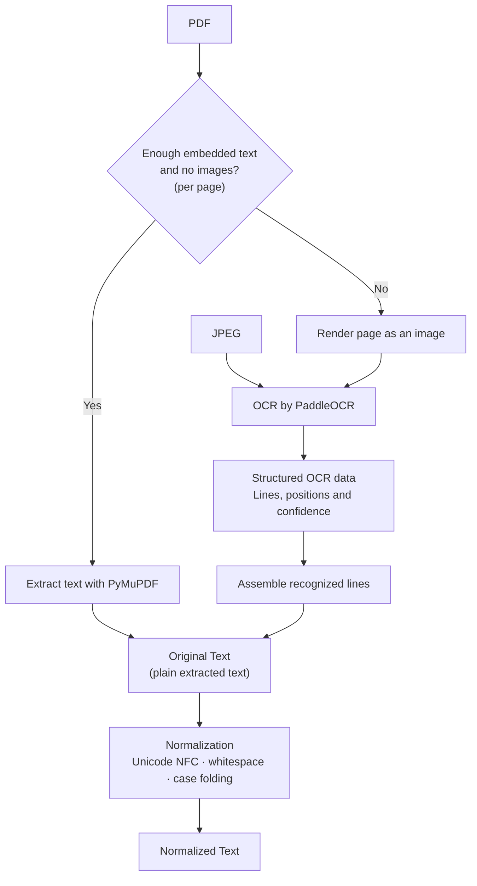

# Document processing pipeline

The diagram shows how PDF and JPEG inputs become searchable text in TrayStack.
It focuses on extraction and normalization; job orchestration, quality checks and
storage are explained below. GitHub renders the diagram directly from the fenced
`mermaid` block at the top of this file.

## Original file versus Original Text

**Original file** is the uploaded PDF or image, stored unchanged with a SHA-256
checksum. Processing creates derived records and files; it does not rewrite the
upload.

**Original Text** in the diagram means the unnormalized plain text produced by
extraction. It is not a byte-for-byte copy of the file, a faithful reproduction of
its layout, or necessarily an accurate transcription. OCR can misrecognize words,
and embedded PDF text can have encoding or reading-order problems.

Both Original Text and Normalized Text are retained. The search interface's
**Original** comparison mode uses the former; **Normalized** uses the latter.

## How we choose between PDF text extraction and OCR

The decision is made **per PDF page**, so one PDF can use both methods.

We extract embedded text with `page.get_text("text", sort=True)`. We use it
directly only when both conditions hold:

- It contains at least **20 characters after trimming leading/trailing whitespace**.
- `page.get_image_info()` detects **no images**, including inline images.

Otherwise, PyMuPDF renders the entire page to an image, which is passed to
PaddleOCR. On that path, the OCR output becomes the page text; we do not merge it
with embedded text.

The image check is conservative. A readable heading can sit above a scanned
contract image; using only the heading would silently omit the contract. The
tradeoff is that a digitally generated page containing only a logo can also
trigger OCR. Passing the 20-character check does not itself establish quality.

## What each extraction tool returns

### PyMuPDF

The `"text"` extraction mode returns a **plain Python string** with text and line
breaks. It does not return Markdown or explicit paragraph, heading or table
objects. Sorting attempts a reading order, but does not guarantee correct reading
order for complex layouts.

We separately request `page.get_text("words", sort=True)` and retain word text and
bounding boxes in PDF points, plus page dimensions. We currently do not retain
the returned block/line identifiers or reconstruct a paragraph hierarchy. This
path has no OCR confidence scores.

### PaddleOCR (default)

The default engine is **PaddleOCR PP-OCRv6 small**, run locally on CPU through
**RapidOCR 3.10.0 and ONNX Runtime**. This multilingual model tier includes English
and German. It targets handwriting-capable recognition; we have not evaluated its
accuracy on our contracts and do not claim a measured improvement over Tesseract.

The runner returns recognized **lines**, confidence values and quadrilateral
polygons in image pixels. We assemble line text with newlines and retain line-level
geometry. These are line boxes, not word boxes, and no paragraph hierarchy is
inferred. The pipeline still produces our own JSON/Markdown artifacts afterwards.

The detector and recognizer models are pinned by SHA-256 in
[ocr_model.py](backend/traystack/ocr_model.py). They are downloaded at build/setup
time, verified before use and used from local files. A subprocess per page enforces
the configured timeout. Missing/corrupt models or inference failures produce an
explicit failed/unavailable result, never a silent fallback to a different engine.

### Tesseract (legacy option)

`OCR_BACKEND=tesseract` retains the previous local engine. Jobs captured before the
backend option was added continue to use Tesseract; reprocessing creates a new job
with the current configured backend. The original source and historical artifacts
remain unchanged.

Tesseract uses `pytesseract.image_to_data(..., output_type=DICT)`, returning words,
confidence and line identifiers. We reconstruct lines and retain word boxes as
left/top/width/height. PyMuPDF boxes use left/top/right/bottom; PaddleOCR line
polygons use four corner points. Each layout record identifies its coordinate space.

## Common page representation and quality checks

Both paths produce the same internal page representation: text, page number,
extraction method, quality information and layout metadata. Page texts are then
assembled into a document; the plain-text page separator is `\n\f\n`.

For PaddleOCR, page confidence is the mean recognized-line score scaled to 0–100;
for Tesseract it is the mean of available nonnegative word scores.
Current warnings include a mean below 80, or more than 20% of available scores
below 50. Missing confidence also produces a warning. These are engine-specific, uncalibrated heuristics: line and word scores are not
interchangeable probabilities, semantic similarity, or proof of correct transcription.
The PaddleOCR detection-limit warning also keeps affected results out of ready search.

Further checks flag empty or suspicious text and honor manual-review requirements.
An extraction failure or OCR timeout is recorded rather than replaced with
invented content. Coverage can be complete, partial or unavailable; quality is
tracked separately.

## Normalization

Normalization uses the versioned rule set `nfc-whitespace-casefold-v1`:

1. Apply Unicode **NFC** to standardize equivalent character encodings.
2. Standardize line endings, collapse consecutive whitespace into one space, and
   trim leading/trailing whitespace.
3. Apply Unicode **case folding**, including converting German `ß` to `ss`.

For example:

```text
Original:    "  Die STRAẞE\n\tist lang.  "
Normalized: "die strasse ist lang."
```

Punctuation, numbers, accents, hyphens and negation remain. We do not stem words,
correct OCR errors or join words split by hyphenation. Normalized text no longer
preserves line or paragraph breaks, and its character positions can differ from
the original text. We retain page offsets for the normalized representation.
The same normalization is applied to the search expression in Normalized mode.

## Where JSON and Markdown enter the pipeline

After extraction and normalization, our Python code produces these outputs:

| Output | Contents and purpose |
| --- | --- |
| PostgreSQL text records | Document/page plain and normalized text, coverage, quality and layout metadata used by the app and search |
| Structured JSON artifact | Extraction results, page/word information, source and processing-run IDs, parameters and processor versions for inspection and provenance |
| Markdown artifact | Extracted page text wrapped in `## Page N` headings for convenient reading |

The JSON is generated by **our application** from the common representation. We
do not simply save Tesseract's complete raw dictionary unchanged. The Markdown
does not reconstruct the source's headings, bold text, lists or tables.

Search reads text records from PostgreSQL; it does not repeatedly parse the JSON
or Markdown artifacts. Original and derived file bytes live in filesystem blob
storage; database records reference them and their checksums.

## How execution is orchestrated

Upload and processing are separate actions:

1. **Upload** validates and stores the original file and creates document,
   revision and artifact metadata. Upload alone does not run extraction.
2. **Start processing** calls the processing API, which inserts a `queued` job in
   PostgreSQL with the source ID and processing settings.
3. A separate **Python worker container** polls the queue. It claims a job with
   `FOR UPDATE SKIP LOCKED`, changes it to `running`, and commits before extraction.
   The database prevents concurrent queued/running jobs for the same revision.
4. The worker verifies the source checksum and runs the extraction pipeline using
   ordinary sequential Python functions, outside a long-running database lock.
5. It writes derived blobs, then publishes their metadata, text records and the
   `completed` job status in one database transaction. A failed job records an
   error; page-level failures can instead yield partial/unavailable extraction.

PostgreSQL stores the queue and state; it **does not store or execute the Python
pipeline code**. The worker code is packaged in its container. We use no
LangChain, LangGraph, Celery or Redis for orchestration. Interrupted running jobs
currently require operator recovery rather than automatic lease-based retries.

## When results become searchable

A completed job is not sufficient on its own. New UI searches include only ready
documents: the latest revision needs nonempty usable text, complete coverage,
`no_known_issue` quality, a completed selected job that is also the latest job,
no persistent manual-review requirement, and supported normalization when used.
Pending, failed, partial or flagged sources stay in document management.

**Embeddings are computed during search, not document processing.** We first find
textually similar candidate windows, then compare embeddings of the query and
those candidates. Candidate passages are text windows, not reconstructed legal
clauses or paragraphs. See the [unified search and review workflow](docs/unified-review.md).

## Other inputs and implementation references

PNG follows the JPEG OCR path. UTF-8 TXT is read directly, while HTML is parsed
into text without executing scripts or fetching external resources; these bypass
OCR. HTML requires manual review. The two-input diagram deliberately keeps these
additional formats out of the main illustration.

- [Upload and artifact API](backend/traystack/main.py)
- [Processing job API](backend/traystack/api/processing.py)
- [Worker loop and recovery](backend/traystack/worker.py)
- [Job claiming and result publication](backend/traystack/services/processing.py)
- [Extraction, OCR and canonical text](backend/traystack/services/text_extraction.py)
- [Normalization rules](backend/traystack/services/normalization.py)
- [Search readiness selection](backend/traystack/services/search.py)
- [User guide](docs/user-guide.md) and [technology inventory](techstack.md)
